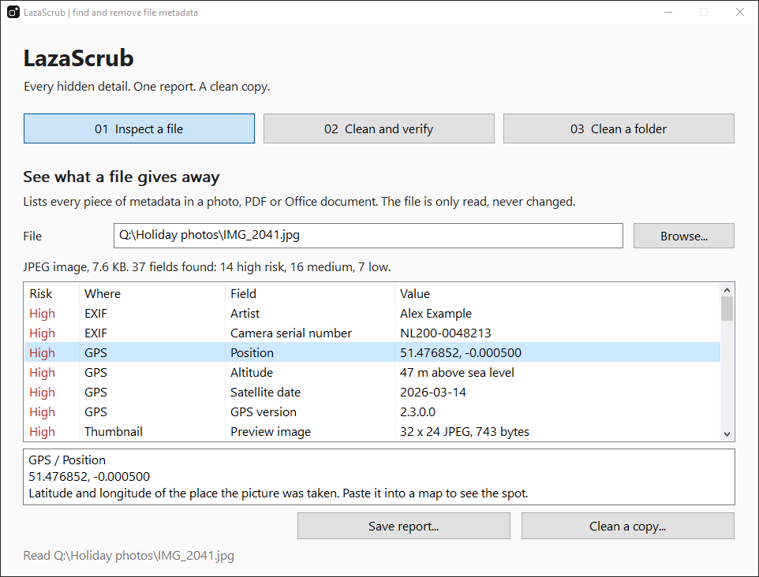
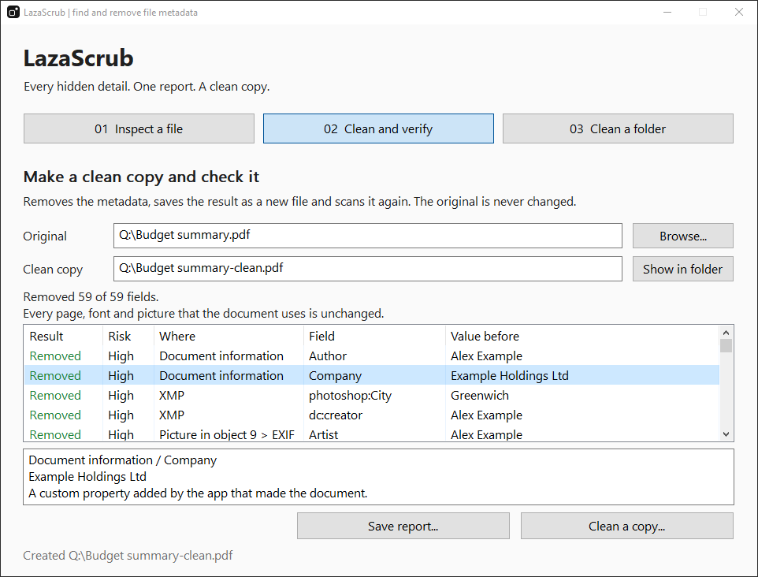

<p align="center"></p>

<h1 align="center">LazaScrub</h1>
<p align="center">Every hidden detail. One report. A clean copy.</p>

<p align="center">
  
  
  <a href="LICENSE"></a>
</p>

**LazaScrub is a portable Windows utility that shows the metadata hidden in photos, PDFs and Office documents, removes it, and checks the result.** It lists every field it finds with a risk rating, writes a cleaned copy, then scans that copy again and confirms that the picture or document itself is unchanged.

[Download the latest Windows release](https://github.com/kimineechan/LazaScrub/releases/latest) · [Usage guide](docs/USAGE.md) · [What it finds](docs/FORMATS.md) · [Report a bug](https://github.com/kimineechan/LazaScrub/issues/new/choose)

<p align="center"></p>

## Features

| Feature | What it does |
| --- | --- |
| Inspect a file | List every piece of metadata, rated high, medium or low risk, with a plain explanation of why it matters |
| Clean a copy | Write a new file without the metadata. The original is never changed |
| Verify the copy | Scan the cleaned file again and confirm that its picture data or document content matches the original |
| Clean a folder | Clean every supported file in a folder into a new folder beside it |
| Save a report | Keep the findings, or the before-and-after result, as text or JSON with SHA-256 hashes |
| Command line | Run the same engine from scripts with `lazascrub-cli.exe` |
| Portable and local | Native Windows interface, no installer, network client, or telemetry |

## What it finds

Metadata is more than a camera model. LazaScrub looks for the details that identify a person, a place or a history:

- **Photos:** GPS position, camera and lens serial numbers, owner and author names, dates, editing history, and the embedded preview image that can still show a picture as it was before it was cropped.
- **PDFs:** author and software, XMP, reviewer names on comments, page thumbnails, and **earlier versions of the document**. PDF editors append changes instead of rewriting the file, so replaced text and old properties often remain. LazaScrub reports them and leaves them out of the cleaned copy.
- **Word, Excel and PowerPoint:** author, company and editing time, comment and tracked-change authors, the path of the template, the folder a workbook was saved in, network printer names, and the metadata of every picture inside the document.
- **Any file:** data appended after the end of the real content, and the hidden Windows record of where a file was downloaded from.

The full list for each file type is in [What LazaScrub finds and removes](docs/FORMATS.md).

## Download and run

1. Open [Releases](https://github.com/kimineechan/LazaScrub/releases).
2. Download `LazaScrub-v1.0.0-windows-x64.zip`.
3. Extract the ZIP and open `LazaScrub.exe`.

LazaScrub targets **64-bit Windows 10 and Windows 11**. It needs no Go, Python, Node, or separate application framework.

Release assets include `SHA256SUMS.txt`. Check the ZIP in PowerShell with:

```powershell
Get-FileHash .\LazaScrub-v1.0.0-windows-x64.zip -Algorithm SHA256
```

Compare the result with its entry in `SHA256SUMS.txt`.

## Inspect, clean and verify

1. Open **01 Inspect a file** and choose a file, or drop one anywhere on the window.
2. Read the list. Select a row to see the full value and why it matters.
3. Select **Clean a copy** and choose where to save it.
4. **02 Clean and verify** shows what was removed, what was kept on purpose, and whether the content of the copy matches the original.

<p align="center"></p>

To clean many files at once, open **03 Clean a folder**, choose the folder and select **Clean all files**. The copies go into a new folder next to it, named after the original with `-clean` added.

See the [usage guide](docs/USAGE.md) for reports, the folder section and the command-line tool.

## Supported files

| Type | Extensions |
| --- | --- |
| JPEG image | `.jpg` `.jpeg` `.jpe` `.jfif` |
| PNG image | `.png` |
| GIF image | `.gif` |
| WebP image | `.webp` |
| PDF document | `.pdf` |
| Word document | `.docx` `.docm` `.dotx` `.dotm` |
| Excel workbook | `.xlsx` `.xlsm` `.xltx` `.xltm` |
| PowerPoint presentation | `.pptx` `.pptm` `.potx` `.potm` `.ppsx` `.ppsm` |

A file is recognised by its content, so a wrong extension does not matter when you open a single file.

## Compatibility and limits

- The original file is never modified. LazaScrub refuses to save the cleaned copy over it.
- Cleaning removes metadata. It does not edit content. Tracked changes, deleted text that Word still stores, hidden sheets and slides, attachments, macros and scripts are reported but left in place, because removing them would change the document.
- Details that a file needs in order to display correctly are kept: the colour profile, the resolution and the orientation of a photo.
- A cleaned PDF is rebuilt from the objects it still uses. Digital signatures become invalid, and a PDF/A file no longer carries its conformance metadata.
- Password-protected PDFs are reported but not cleaned. Remove the password first.
- Anything stored after the end of a picture is removed. For a motion photo this includes the short video.
- HEIC, TIFF and camera RAW files, video, audio, OpenDocument files and the older `.doc`, `.xls` and `.ppt` formats are not supported in this version.
- Each file may be up to 1 GiB.
- The executables are unsigned, so Windows SmartScreen may ask for confirmation the first time.

No tool can promise that a file is free of every identifying detail. LazaScrub removes what it recognises and shows you what remains, so check the result before you share a sensitive file.

## Build from source

Install [Go](https://go.dev/dl/) 1.25 or newer, clone the repository, and open a terminal in its root:

```powershell
git clone https://github.com/kimineechan/LazaScrub.git
cd LazaScrub
.\build.cmd
```

The results are `dist\LazaScrub.exe` and `dist\lazascrub-cli.exe`. The build script runs `go vet` and the tests, builds both programs, then runs a round trip on sample files of every supported type.

The project uses the Go standard library and native Windows APIs. No third-party Go modules are required. The icon and the Windows resources are generated by `tools/mkres`, which is also plain Go.

Create the release ZIP after building:

```powershell
.\scripts\package.ps1
```

See [CONTRIBUTING.md](CONTRIBUTING.md) for development checks and [docs/GITHUB.md](docs/GITHUB.md) for release publishing.

## How it works

Each file type has its own reader, written for this project: the JPEG segment layout, the TIFF structure of EXIF, RDF for XMP, PNG and RIFF chunks, GIF blocks, the PDF object model with its cross-reference tables and streams, and the parts of an Office package. Nothing is rendered or run.

Cleaning copies the bytes that make up the picture or document and leaves out the rest. Picture data is never re-encoded. A PDF is rebuilt from the objects its catalog leads to, which drops document information, XMP and everything that earlier saves left behind. In an Office file the property parts are emptied, a few parts are removed, and untouched parts are copied as stored.

After cleaning, the copy is scanned again and a SHA-256 fingerprint of its content is compared with the original's. For a picture the fingerprint covers the compressed picture data, so a match means the two files decode to the same pixels.

Implementation details and checks are in [VALIDATION.md](VALIDATION.md).

## Contributing and licence

Bug reports, files that are read incorrectly, and focused pull requests are welcome. Please read [CONTRIBUTING.md](CONTRIBUTING.md).

MIT licence. See [LICENSE](LICENSE). The Go runtime and standard library notice is included in [THIRD-PARTY-NOTICES.txt](THIRD-PARTY-NOTICES.txt).
